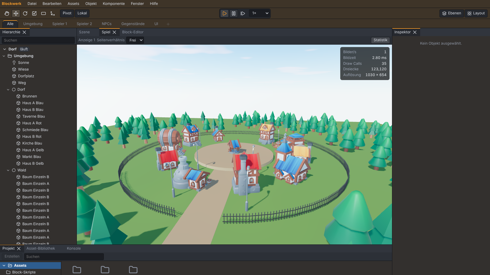

# Blockwerk

**Use it like Unity, program it like Scratch, play it like a real game.**

Blockwerk (working title) is a free, open-source 3D game engine. The editor is laid out like
Unity's: Hierarchy, Scene, Game, Inspector, Project and Console, objects with components, prefabs
and a play mode. The game logic, however, is built with Scratch-like command blocks instead of C#.

The editor and the engine are available in **English and German**; everything else in this
repository (documentation, issues, pull requests) is in English.



> **Status:** early development. Phases 0 to 10 are done (editor, block scripts, asset library,
> player, physics, environment, NPCs, UI and saving, large projects, debugging, build and export,
> and an optional AI assistant with your own key, see [docs/ai.md](docs/ai.md)). To try it out:
> "File → Open Example Project" or "File → New Project from Template" (five small games,
> [docs/templates.md](docs/templates.md)) and press Play; "File → Build Settings" makes a web build or a
> Windows app of a game ([docs/export.md](docs/export.md)). See the [roadmap](#roadmap) for the
> current state.

## Download

Once there is a release, the Windows installer and a portable `.exe` will be on the
[Releases](https://github.com/tmluc-cool/Blockwerk/releases) page. Until then, run Blockwerk from
source (see below).

## Quick start for developers

Requirements: [Node.js](https://nodejs.org/) LTS (22.12 or newer) and [pnpm](https://pnpm.io/) 10.

```sh
pnpm install
pnpm assets:fetch   # download and process the asset library (once, about 15 minutes, 150 MB)
pnpm dev            # editor in the browser (http://localhost:5173)
pnpm dev:desktop    # editor in Electron
pnpm test           # unit and golden tests
pnpm test:e2e       # Playwright (builds first; on Linux without a display: xvfb-run -a pnpm test:e2e)
pnpm lint           # ESLint, Prettier, license check
pnpm build          # type check and build of the editor and the desktop app
pnpm docs:reference # regenerate docs/reference (all blocks and components, with the Unity counterpart)
```

Details on the layout, the rules and how to contribute are in [CONTRIBUTING.md](CONTRIBUTING.md).

## Unity terms in Blockwerk

The English interface uses the familiar Unity terms directly. The German interface uses these
translations:

| Unity (English interface)                                     | German interface                                      |
| ------------------------------------------------------------- | ----------------------------------------------------- |
| GameObject                                                    | Objekt                                                |
| Component                                                     | Komponente                                            |
| MonoBehaviour / C# script                                     | Block-Skript                                          |
| Prefab, Prefab Variant                                        | Prefab, Prefab-Variante                               |
| Scene                                                         | Szene                                                 |
| Hierarchy, Scene View, Game View, Inspector, Project, Console | Hierarchie, Szene, Spiel, Inspektor, Projekt, Konsole |
| Play Mode                                                     | Play-Modus                                            |
| Asset Store / Package Manager                                 | Asset-Bibliothek                                      |
| Tag, Layer                                                    | Tag, Ebene                                            |
| Rigidbody, Collider, Character Controller                     | Rigidbody, Collider, Charakter-Controller             |
| NavMesh, NavMesh Agent                                        | Navigationsnetz, Nav-Agent                            |
| Input Actions                                                 | Eingabe-Aktionen                                      |
| _(new)_                                                       | Area tabs, Test area, Character Studio                |

New in Blockwerk compared to Unity: area tabs (Environment, Player 1, Player 2, NPCs, Items, UI), a test area for
trying out characters, the Character Studio and an asset library with CC0 models.

## Roadmap

| Phase | Content                                       | Status  |
| ----- | --------------------------------------------- | ------- |
| 0     | Foundation and Unity layout                   | ✅ done |
| 1     | Objects, components, block scripts, play mode | ✅ done |
| 2     | Project window, asset library, prefabs        | ✅ done |
| 3     | Player, physics, animation                    | ✅ done |
| 3b    | Character Studio                              | ✅ done |
| 4     | Environment and graphics                      | ✅ done |
| 5     | NPCs and game logic                           | ✅ done |
| 6     | UI, menus, saving                             | ✅ done |
| 7     | Large projects                                | ✅ done |
| 8     | Debugging                                     | ✅ done |
| 9     | Build and export                              | ✅ done |
| 10    | AI assistant                                  | ✅ done |
| 11    | Polish and final acceptance                   | planned |

The full specification is in [SPEC.md](SPEC.md) (German), the progress of each phase in
[PROGRESS.md](PROGRESS.md).

## Principles

- Everything is free, local and offline. No account, no build limits, no telemetry. The only
  exception is the optional AI assistant, which talks to Anthropic with your own key and is
  invisible without one.
- Projects are readable files and friendly to Git.
- The bundled asset library contains CC0 models only.

## License

The code is licensed under the [MIT License](LICENSE). Dependencies and their licenses are listed
in [THIRD_PARTY.md](THIRD_PARTY.md). Blockwerk is an independent project and is not affiliated
with Unity Technologies or the Scratch Team at MIT.
