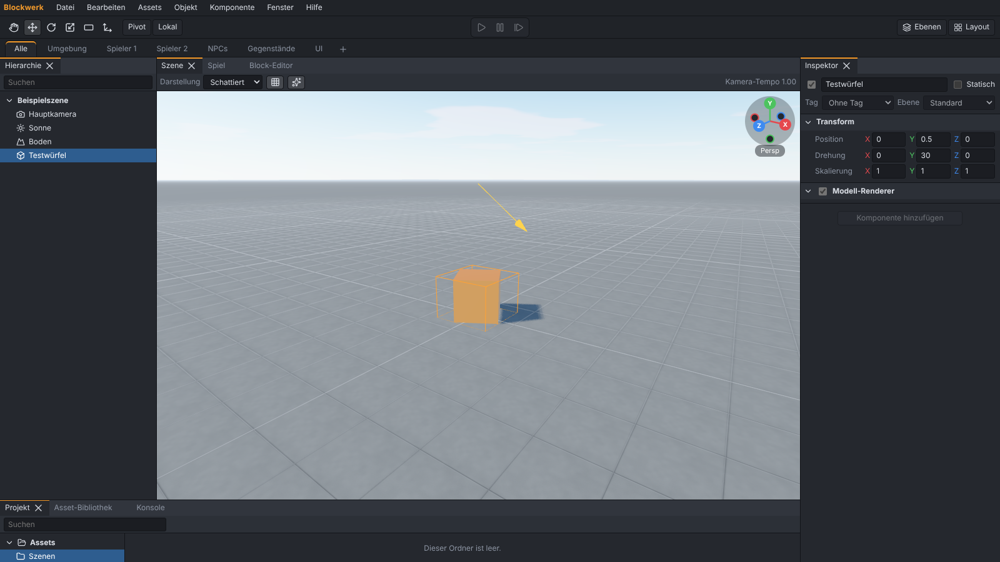

# Blockwerk

**Bedienen wie Unity, programmieren wie Scratch, spielen wie ein echtes Spiel.**

Blockwerk (Arbeitstitel) ist eine kostenlose, quelloffene 3D-Game-Engine. Der Editor ist wie Unity
aufgebaut: Hierarchie, Szene, Spiel, Inspektor, Projekt und Konsole, Objekte mit Komponenten,
Prefabs und Play-Modus. Die Logik baust du aber mit Scratch-artigen Befehlsblöcken statt mit C#.

_English: Blockwerk is a free, open-source 3D game engine with a Unity-style editor. Game logic is
built with Scratch-like command blocks instead of C#. The user interface is available in German
and English._



> **Status:** frühe Entwicklung. Phase 0 (Fundament und Unity-Layout) ist umgesetzt.
> Es gibt noch kein Release. Den aktuellen Stand zeigt die [Roadmap](#roadmap).

## Download

Sobald es ein Release gibt, liegen der Windows-Installer und eine portable `.exe` unter
[Releases](https://github.com/tmluc-cool/Blockwerk/releases). Bis dahin startest du Blockwerk aus
dem Quellcode (siehe unten).

## Schnellstart für Entwickler

Voraussetzungen: [Node.js](https://nodejs.org/) LTS (22.12 oder neuer) und [pnpm](https://pnpm.io/) 10.

```sh
pnpm install
pnpm dev            # Editor im Browser (http://localhost:5173)
pnpm dev:desktop    # Editor in Electron
pnpm test           # Unit- und Golden-Tests
pnpm test:e2e       # Playwright (baut vorher; unter Linux ohne Bildschirm: xvfb-run -a pnpm test:e2e)
pnpm lint           # ESLint, Prettier, Lizenzprüfung
pnpm build          # Typprüfung und Build von Editor und Desktop-App
```

Details zu Aufbau, Regeln und Beiträgen stehen in [CONTRIBUTING.md](CONTRIBUTING.md).

## Unity-Begriffe in Blockwerk

| Unity                                                         | Blockwerk (Deutsch)                                   |
| ------------------------------------------------------------- | ----------------------------------------------------- |
| GameObject                                                    | Objekt                                                |
| Component                                                     | Komponente                                            |
| MonoBehaviour / C#-Skript                                     | Block-Skript                                          |
| Prefab, Prefab Variant                                        | Prefab, Prefab-Variante                               |
| Scene                                                         | Szene                                                 |
| Hierarchy, Scene View, Game View, Inspector, Project, Console | Hierarchie, Szene, Spiel, Inspektor, Projekt, Konsole |
| Play Mode                                                     | Play-Modus                                            |
| Asset Store / Package Manager                                 | Asset-Bibliothek                                      |
| Tag, Layer                                                    | Tag, Ebene                                            |
| Rigidbody, Collider, Character Controller                     | Rigidbody, Collider, Charakter-Controller             |
| NavMesh, NavMesh Agent                                        | Navigationsnetz, Nav-Agent                            |
| Input Actions                                                 | Eingabe-Aktionen                                      |
| _(neu)_                                                       | Bereichs-Reiter, Testgelände, Figuren-Studio          |

Die englische Oberfläche verwendet die Unity-Begriffe direkt.

## Roadmap

| Phase | Inhalt                                          | Status       |
| ----- | ----------------------------------------------- | ------------ |
| 0     | Fundament und Unity-Layout                      | ✅ umgesetzt |
| 1     | Objekte, Komponenten, Block-Skripte, Play-Modus | geplant      |
| 2     | Projekt-Fenster, Asset-Bibliothek, Prefabs      | geplant      |
| 3     | Spieler, Physik, Animation                      | geplant      |
| 3b    | Figuren-Studio                                  | geplant      |
| 4     | Umgebung und Grafik                             | geplant      |
| 5     | NPCs und Spiellogik                             | geplant      |
| 6     | UI, Menüs, Speichern                            | geplant      |
| 7     | Grosse Projekte                                 | geplant      |
| 8     | Debugging                                       | geplant      |
| 9     | Build und Export                                | geplant      |
| 10    | KI-Assistent                                    | geplant      |
| 11    | Feinschliff und Endabnahme                      | geplant      |

Die vollständige Spezifikation steht in [SPEC.md](SPEC.md), der Fortschritt jeder Phase in
[PROGRESS.md](PROGRESS.md).

## Grundsätze

- Alles kostenlos, lokal und offline. Keine Konto-Pflicht, keine Build-Limits, keine Telemetrie.
- Projekte sind lesbare Dateien und Git-freundlich.
- Die mitgelieferte Asset-Bibliothek enthält nur CC0-Modelle.

## Lizenz

Der Code steht unter der [MIT-Lizenz](LICENSE). Abhängigkeiten und ihre Lizenzen:
[THIRD_PARTY.md](THIRD_PARTY.md). Blockwerk ist ein eigenständiges Projekt und steht in keiner
Verbindung zu Unity Technologies oder dem Scratch-Team des MIT.
